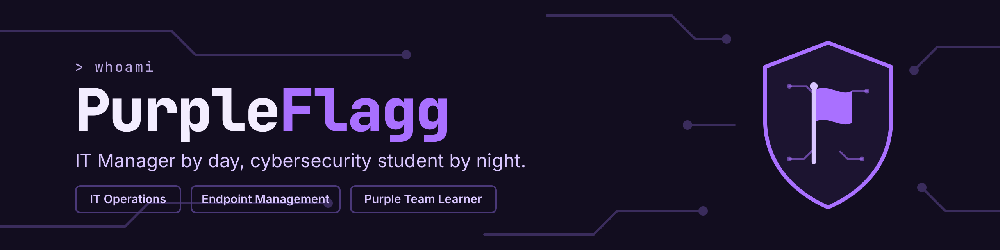

# Hey, I'm Jasmine 💜🚩

**IT Manager by day, cybersecurity student by night: learning both sides of the flag.**

Based in the Cincinnati area, I keep people, devices, and systems running smoothly, while building toward a career in cybersecurity. It's only right that my handle comes from purple teaming, as I've always had a natural curiosity to see how both systems are attacked and how they're defended.

## 🛠️ What I Do

- 👥 Own end-to-end IT operations, including employee support, site installations, inventory, and on-call response
- 🔄 Lead endpoint management
- ⚙️ Streamline IT workflows

## 📂 Featured Projects

- **[IT Request Triage Automation](https://github.com/PurpleFlagg/it-request-triage-automation):** turned a manual IT request sheet into a prioritized, self-monitoring queue with Google Apps Script
- **[Windows MDM Evaluation](https://github.com/PurpleFlagg/windows-mdm-evaluation):** led the vendor evaluation to replace SimpleMDM during a macOS-to-Windows migration

## 🎓 What I'm Learning

- 🔐 Pursuing a B.S. in Cybersecurity
- 🚩 Practicing hands-on security skills
- 📚 Working toward industry certifications

## 🏅 Credentials & Community

- ✅ Google IT Support Professional Certificate (2023)
- 💜 Member of Women in Cybersecurity (WiCyS)
- 🤝 Member of the SNHU Cyberleague Club

## 🧭 Background

Before moving into IT leadership, I worked in healthcare, banking, and customer and tech support. That experience taught me that good security and good IT both start with understanding the people who use the technology.

## 🧰 Tools & Tech

## 📫 Connect With Me

*Currently: learning, labbing, and capturing flags.* 🚩
